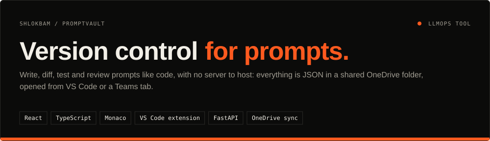
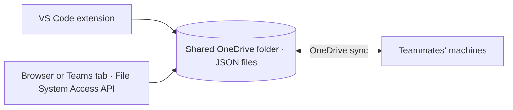
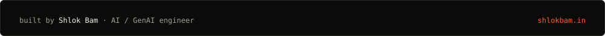

<div align="center">




<a href="SETUP_GUIDE.md">Setup guide</a> · <a href="#what-it-does">What it does</a> · <a href="#how-it-works">How it works</a> · <a href="#quickstart">Quickstart</a> · <a href="#design-decisions">Decisions</a> · <a href="docs/DETAILS.md">Full notes</a>

</div>

## In one minute

- **Problem:** teams tweak system prompts in chats and text files, then can't say what changed between v2 and v3, or whether it still passes its tests. Hosting a prompt tool means a security review.
- **What this does:** a prompt workspace with a Monaco editor, side-by-side version diffs, a test manager, comments and an audit trail. It stores everything as readable JSON in a OneDrive folder the team already shares.
- **Result:** installs from one `.vsix` file and runs with zero servers, so it fits locked-down company laptops.

## What it does

| Feature | Details |
| :--- | :--- |
| Prompt editor | Monaco (the VS Code editor) with line numbers, word and character counts, download and fullscreen |
| Version diff | Pick any two versions and see added and removed lines side by side |
| Test manager | Record questions and expected outputs, mark actual outputs pass or fail, keep the history |
| Review | Comments on each revision and a full audit trail: who changed what, and when it was promoted |
| Two front doors | A VS Code sidebar, or a browser tab you can pin in Microsoft Teams |

## How it works



| Part | What it does |
| :--- | :--- |
| `vscode-extension/src/extension.ts` | Runs the UI in a VS Code webview and reads and writes the JSON files |
| `frontend/src/services/api.ts` | One bridge: talks to the extension, the browser file API or the optional server |
| `frontend/src/pages/` | Dashboard, editor, compare, activity log, search and settings |
| `backend/` | Optional FastAPI server for a hosted setup |

## Quickstart

**VS Code (no terminal needed):** Extensions → `…` → *Install from VSIX* → pick `promptvault-1.0.0.vsix`, then set *PromptVault: Database Path* to your shared OneDrive folder. Full walkthrough, including Teams: [SETUP_GUIDE.md](SETUP_GUIDE.md).

**From source:**

```bash
cd frontend && npm install && npm run dev        # web UI
cd vscode-extension && npm install && npm run compile
```

## Design decisions

- **Files, not a database.** JSON in OneDrive means no server, no new vendor and nothing for IT to approve, and every change is still readable by a person.
- **One UI, two hosts.** The same React app runs inside VS Code and in a browser; a small bridge decides where to read and write.
- **Tests live next to prompts.** Each prompt keeps its test cases and pass/fail history in the same place as its versions.

## Limits & roadmap

- [ ] Simultaneous edits rely on OneDrive's own conflict handling; an in-app merge view would be safer
- [ ] Run test cases against a model automatically instead of pasting outputs by hand

---

<div align="center">

<a href="https://shlokbam.in"></a>

<a href="https://shlokbam.in">shlokbam.in</a> · <a href="https://www.linkedin.com/in/shlokbam/">LinkedIn</a> · <a href="https://github.com/shlokbam">More projects</a>

</div>
